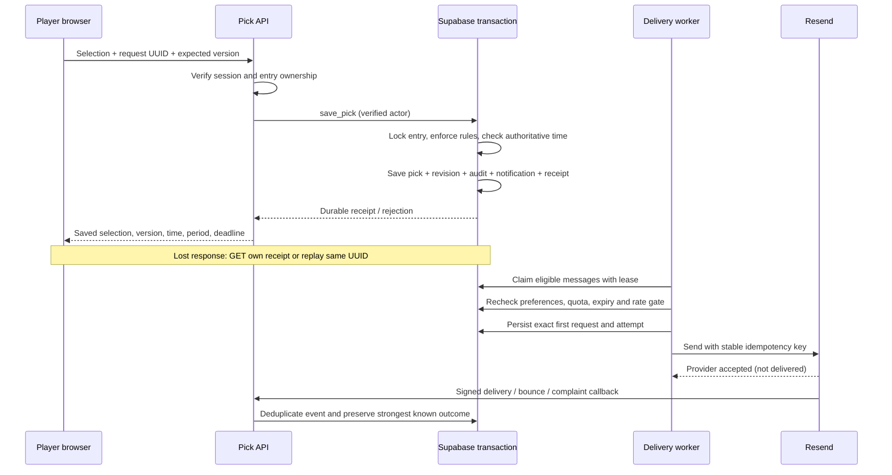
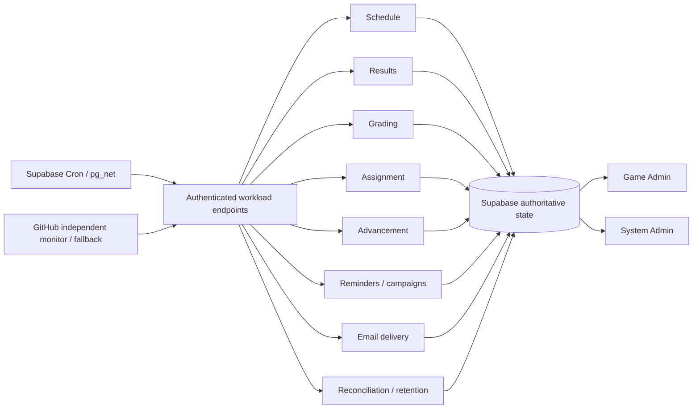

# Architecture decision

Keep Supabase Postgres authoritative and extend the existing outbox and operation records. Keep the existing application on Vercel. No Redis, new service, subscription or second contest-state store is introduced.

| Approach | Reliability / maintenance | Observability | Cost / coupling | Decision |
|---|---|---|---|---|
| A. Extend Postgres outbox and jobs | Reuses established transactions, claims, recovery and backup tooling; application owns leases/retries. | Queryable business intent, receipts, attempts and incidents in one DB. | Existing DB/API usage; code maintained here. | Selected. Smallest coherent extension. |
| B. Supabase Queues (pgmq) | Native durable transport and visibility windows; still needs business history, expiry, provider idempotency and reconciliation. | Queue dashboard plus application records; two representations to reconcile. | Same platform; extension/version/configuration dependence. | Reasonable future transport, unnecessary migration now. |
| C. Dedicated job platform | Better execution tooling may help long work and scheduling. Does not replace DB guards or solve email ambiguity. | Usually richer workflow history, alongside business records. | New credentials, vendor dependence, usage/account decisions; account pricing not assumed. | Reconsider only if hosted tests show execution limits or operations burden. |

## Acceptance and delivery

Each recurring workload has a stable key, next-due timestamp, expiring ownership token, attempts, last success, progress and correlation ID. Invocation time need not match a minute modulus. Failed jobs back off; abandoned leases can be reclaimed; stale completion is rejected. Tournament mutations use their own DB invariants and assignment tokens as well as the outer job lease. Already committed entry work survives a partial batch.

Delivery has separate processing state and provider outcome. `sent` is the compatibility database value for **provider accepted**; the admin interface labels it correctly. Attempts are appended, with completion metadata filled once. Provider-event records are deduplicated by signed event ID. No end-to-end exactly-once guarantee is claimed.

A claimed message has a two-minute lease; an invocation claims only 30 at a time. One database rate gate spaces requests by at least 550ms across workers. A delivery invocation drains bounded batches for roughly 160 seconds, with a 240-second outer lease and 300-second function limit. Slow or interrupted work is recovered; the rate is conservative and must be checked against the actual paid account. Callback-before-response races and lost responses retain the same provider key and frozen payload. Retries beyond 23 hours from the first attempt require review, inside Resend's documented 24-hour window.

## Platform facts checked against official documentation

- [Vercel Hobby cron limits](https://vercel.com/docs/cron-jobs/usage-and-pricing): daily minimum interval and loose invocation timing. Its native cron is not a precise deadline scheduler.
- [Function duration limits](https://vercel.com/docs/functions/limitations): Fluid Compute supports longer durations; confirm the project's effective settings before activation.
- [GitHub scheduled events](https://docs.github.com/en/actions/reference/workflows-and-actions/events-that-trigger-workflows#schedule): delay/drop conditions mean it cannot establish a deadline SLA.
- [Supabase Cron](https://supabase.com/docs/guides/cron) and [Vault-backed HTTP scheduling](https://supabase.com/docs/guides/functions/schedule-functions): configuration template provided, not activated.
- [Supabase Queues](https://supabase.com/docs/guides/queues): native Postgres transport; visibility-window semantics do not prove exactly-once business effects.
- [Resend pricing](https://resend.com/pricing), [usage limits](https://resend.com/docs/api-reference/rate-limit), [idempotency](https://resend.com/docs/dashboard/emails/idempotency-keys): the Free daily allowance cannot carry a 1,000-message wave. User intends paid Resend, not connected or activated. Exact account quota/rate and billing remain activation checks.
- [Supabase backups](https://supabase.com/docs/guides/platform/backups): free projects should maintain exports/off-site backups; paid managed backup behavior must not be assumed.
